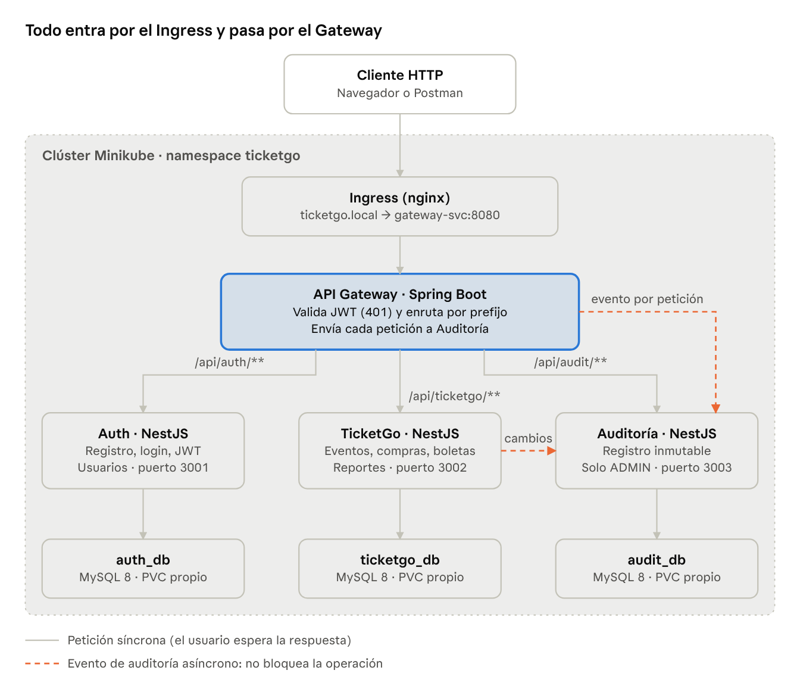

# TicketGo — Eventos y Boletería

Proyecto final de Arquitectura de Microservicios (Grupo 3). TicketGo permite a una empresa organizadora publicar eventos, vender boletas por localidad y validar el ingreso de los asistentes con un código único.

## Arquitectura



| Componente | Tecnología | Responsabilidad | Base de datos |
| --- | --- | --- | --- |
| Ingress | Kubernetes Ingress (nginx) | Única entrada externa, envía todo al Gateway | — |
| API Gateway | Spring Boot (Spring Cloud Gateway) | Valida el JWT, enruta y reporta cada petición a Auditoría | — |
| Auth | NestJS + TypeORM | Registro, login, JWT con rol y gestión de usuarios | `auth_db` (MySQL) |
| TicketGo | NestJS + TypeORM | Escenarios, eventos, precios, compras, boletas, validación y reportes | `ticketgo_db` (MySQL) |
| Auditoría | NestJS + TypeORM | Registro inmutable de peticiones y cambios | `audit_db` (MySQL) |

Roles: `ADMIN`, `ORGANIZADOR`, `CLIENTE`. El diseño completo está en [`docs/`](docs/).

## Estructura del repositorio

```
gateway/                  API Gateway (Spring Boot)
services/auth-service/    Microservicio de autenticación
services/ticketgo-service/ Microservicio de negocio
services/audit-service/   Microservicio de auditoría
k8s/                      Manifiestos de Kubernetes
docs/                     Diseño y documentación
```

## Integrantes

| Integrante | Responsabilidad |
| --- | --- |
| Jhonatan Tamayo | Repositorio, microservicio Auth y reportes |
| Isabella Cruz | Escenarios, localidades, eventos y precios |
| Juan Pablo Aguirre | Compras, boletas y validación |
| Ethan Jacobo Lopez| Auditoría y API Gateway |

## Convenciones de trabajo

- **GitFlow:** `main` (entregas), `develop` (integración) y ramas `feature/<tema>`, `fix/<tema>`, `release/<versión>`.
- No se hace push directo a `main` ni a `develop`: todo entra por Pull Request a `develop` con al menos una aprobación de otro integrante.
- **Commits:** formato `tipo(alcance): descripción`, por ejemplo `feat(auth): login con JWT` o `fix(compras): validar límite de boletas`. Tipos: `feat`, `fix`, `test`, `docs`, `chore`, `refactor`.
- Los secretos reales nunca se suben; en `k8s/secrets/` solo van archivos `*.example.yaml`.

## Cómo ejecutarlo

Pendiente: se documentará cuando estén listos los servicios y el despliegue en Minikube.
